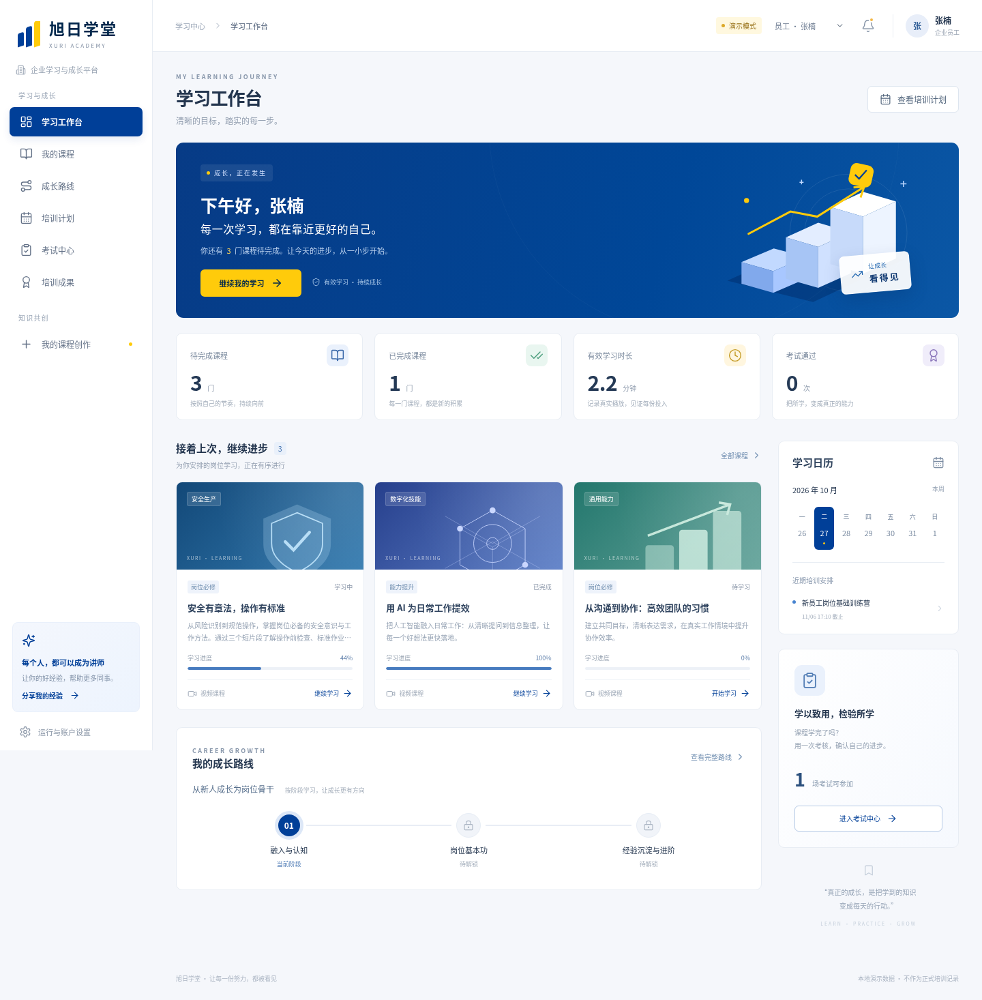

# 旭日培训系统 · 旭能学院

企业内部培训系统，后端使用传统 SSM（Spring、Spring MVC、MyBatis），数据库使用 SQL Server，前端使用 Vue 3。蓝色 `#003f98`、深蓝 `#00274c` 与黄色 `#ffcb0b` 组成统一视觉。

当前提供前后端首版，支持员工兼任讲师、课程审核、岗位成长路线、培训计划、有效播放校验、课程关联考试、预警处理记录，以及课程问答和 AI 出题草稿接口。

## 没有数据库，也可以先体验

下载整个仓库，解压后双击 **`demo/旭日学堂-离线演示.html`**。无需安装 Node.js、JDK、Maven、Tomcat 或数据库，页面和30秒示例视频均已内嵌。右上角可以体验员工、讲师、管理员和独立复核管理员。

演示数据仅保存在浏览器，明确标记为演示，不作为正式培训结果。课程问答和AI出题返回带有说明的固定示例；真实模型需要在后端配置。

## 项目文档

- [后端源码与部署说明](sys/README.md)
- [Vue前端与Windows运行说明](frontend/README.md)
- [离线演示说明](demo/使用说明.txt)
- [前端验证记录](demo/前端验证说明.md)
- [详细设计 V1.1](sys/docs/需求与设计V1.1.md)
- [接口与联调说明](sys/docs/API.md)
- [验证记录](sys/docs/验证记录.md)
- [SQL Server 数据库脚本](sys/database)

## 源码运行

后端：在 `sys` 目录使用完整 JDK 17 或 21 执行 `mvn clean verify`，将生成的 WAR 部署到 Tomcat 10.1。真实业务需要初始化SQL Server。

前端：Node.js 22.12+，在 `frontend` 目录执行 `npm ci`、`npm run dev`，默认演示模式。后端就绪后在页面设置切换模式，开发代理默认指向 `localhost:8080/training/api`。Windows PowerShell可使用 `npm.cmd` 执行命令。

后端基线测试为49项通过、1项SQL Server实测跳过；前端演示规则有独立自动测试，并另行核验浏览器流程。数据库实际联调和真实AI调用尚未验证。数据库密码、初始管理员密码和模型密钥通过部署环境变量配置，仓库仅保留配置模板。
