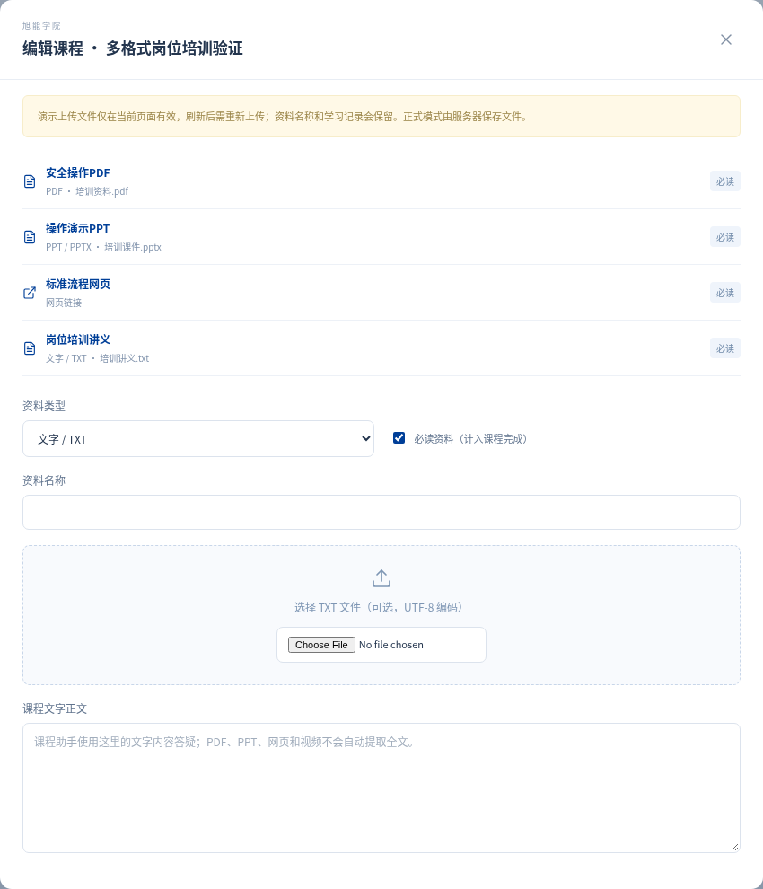
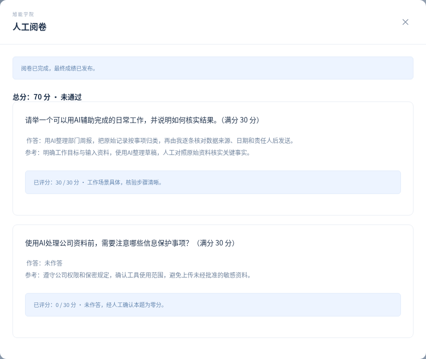
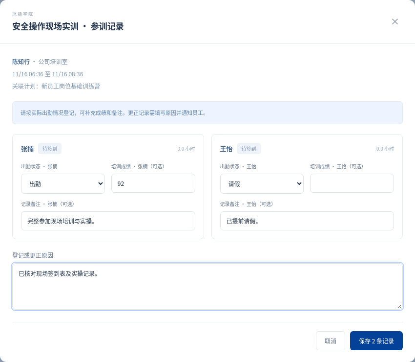
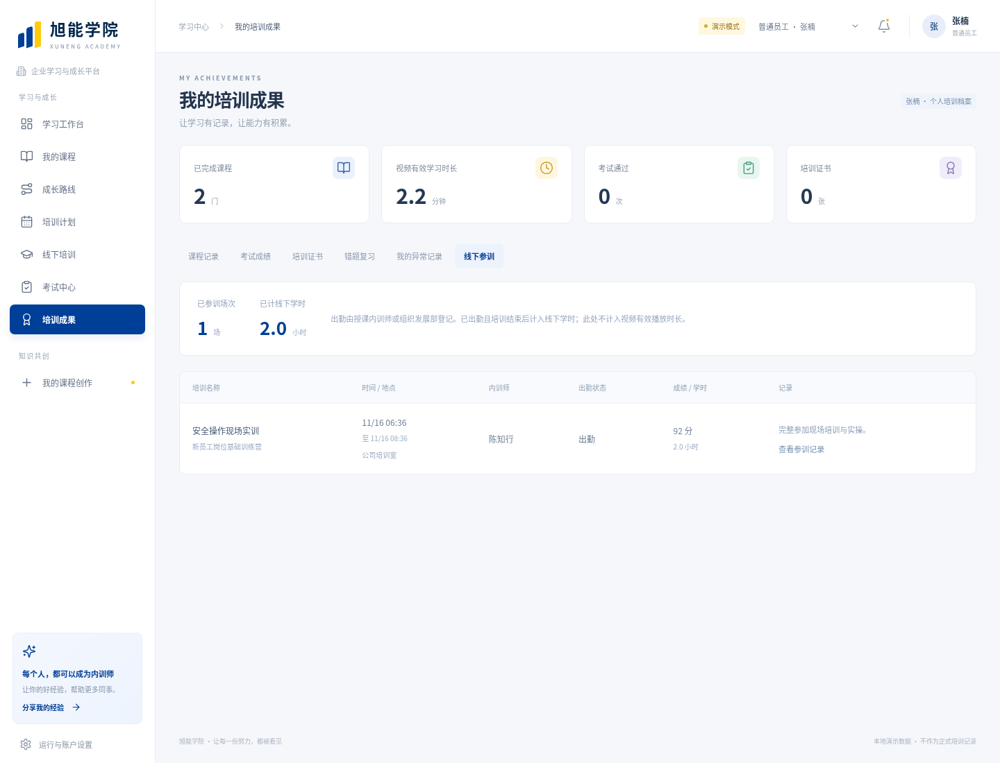
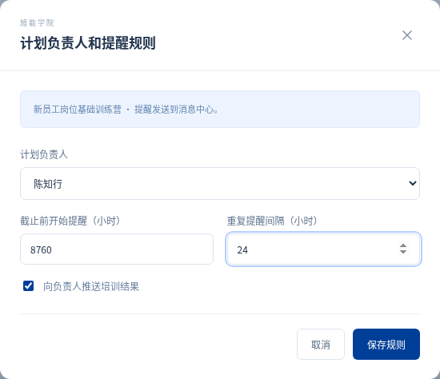
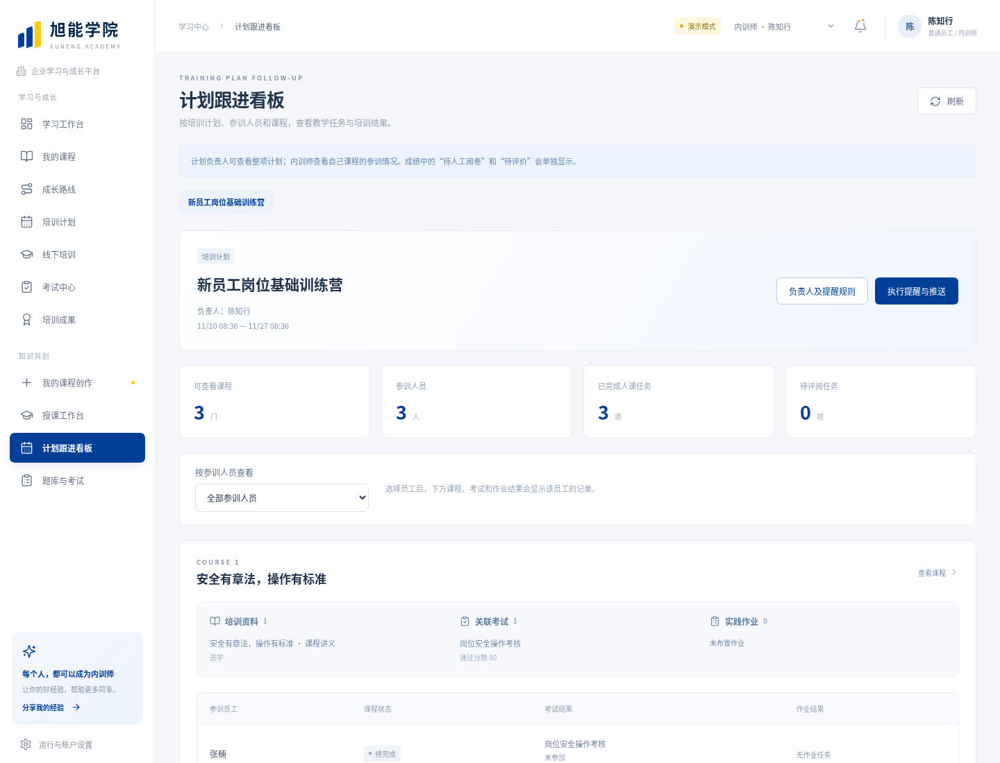

# 旭能学院 V1.3 六项培训功能验证

日期：2026-11-17。配套 [操作说明](六项培训功能使用说明.md)、[流程设计](../sys/docs/培训流程V1.3.md) 和 [机器可读结果](六项培训功能测试结果.json)。

## 自动检查

前端 `npm test` 共52项通过，`npm run build` 成功，重新生成Vue生产文件与单文件离线演示。后端 `mvn clean verify` 共216项，其中215项通过、1项SQL Server实库检查因未配置连接跳过，没有失败或错误，生成新版 `training.war`。

新测试覆盖自动账号、首次改密、文件真实格式与访问权限、资料完成门槛、计划权限与通知去重、人工阅卷和线下参训。此前的视频有效播放、拖动/多开、考试前置、部门岗位、角色和加课规则继续通过。HTTP控制器和MyBatis映射解析也纳入检查。测试中的账号、员工与资料均为虚构样例。

## 浏览器实际操作

Chromium通过本地HTTP加载本次构建的同一个单文件，分别检查以下流程，共28项浏览器检查通过，没有页面JavaScript错误：

- **员工账号（6项）**：实际添加两名同名员工，表单无需填写账号密码；每次仅新增一条关联记录，账号及初密各不相同；初密不写入浏览器存储，关闭、刷新后只保留账号。另用独立HTTP契约响应验证首次登录跳转改密页，只获取本人身份，不请求课程或通知；两次新密码不一致时不提交，改密成功后退出并回到登录页。此部分没有连接真实Tomcat或SQL Server。
- **简答阅卷（9项）**：员工完成客观题和一道简答，另一简答留空，交卷后状态为待阅卷且总分为空。内训师对第一道简答给30分和评语后仍未发布总分；对空题人工确认0分后，总分为70分、未通过，员工成果同步显示。两个已评题不可再次编辑，待阅队列移除，评语保留。“未通过”是该试卷的预期结果，浏览器检查本身通过。
- **资料、计划与线下（13项）**：通过上传控件上传有效PDF、PPTX、TXT并添加HTTP(S)链接，纯资料课程无需视频即可审核、发布和分配。打开PDF不自动完成，只有全部必读资料确认后才完成，未产生视频时长。登记线下出勤、请假、成绩和原因后，员工个人记录可见本人结果，不含其他人员的备注；线上进度未改变。设置负责人和提醒规则，重复执行通知数量不增加，负责人能看到结果摘要和按计划关联的课件、考试、作业。390px手机布局无横向溢出；加载后断网仍可导航、查看参训记录。

线下报名统一使用与真实后端一致的 `REGISTERED` 状态，界面显示“待签到”；旧演示中的待签到状态会兼容转换。地点上限与后端统一为200字符，并已增加回归检查。

## 当前验证边界

尚未连接真实SQL Server执行05迁移，未完成Tomcat与SQL Server的端到端联调、长期定时运行、并发负载或实际公司网络验收。SQL脚本已静态检查，可重复执行并有事务回滚；这些检查不替代数据库管理员在部署环境的验证。

离线演示通过HTTP加载后断网测试，没有直接验证浏览器 `file://` 双击；不要修改公司浏览器安全策略来绕过限制。上传文件在演示中仅保留当前页面的临时文件地址，刷新后附件需重新上传，资料名称和学习确认仍保留；真实后端按存储配置保存文件。

PDF按浏览器能力预览或下载。PPT/PPTX已验证上传容器与下载响应，页面提供下载后使用Office或兼容软件打开，不提供在线PPT转换，也没有在本执行环境运行Office。外链只验证和保存HTTP(S)地址，不自动抓取网页。资料阅读是主动确认，不等同于视频有效播放证明。

站内提醒和结果摘要在真实后端每小时检查；离线演示只在页面操作时模拟，不会在关闭页面后定时运行。本次没有发送邮件或外部聊天消息。AI服务仍需另行配置，不代表已经实际调用模型。

## 正式升级

对现有培训数据库，先确认02、03、04已按版本执行，再由有权限的数据库管理员执行 `sys/database/05-training-workflows.sql`，最后更新 `training.war`。无需创建新数据库或重跑全量建表脚本。全新数据库使用最新01建表脚本，包含三个固定岗位及本次新增表和字段。
