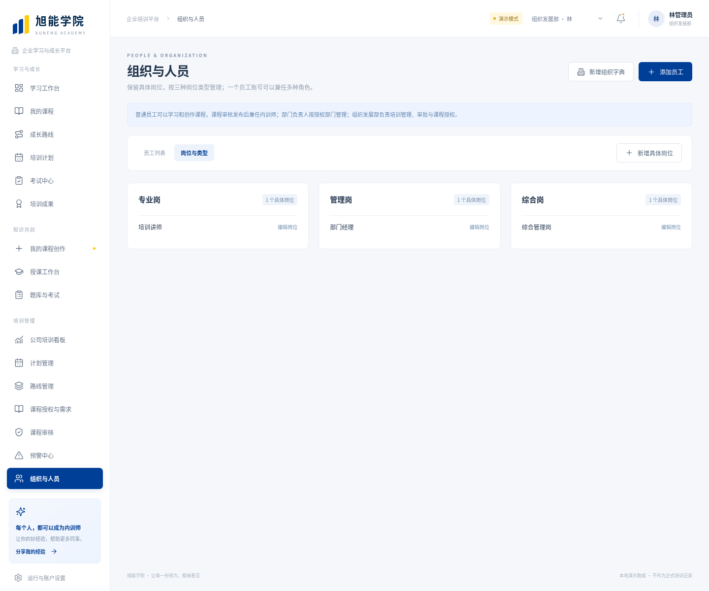
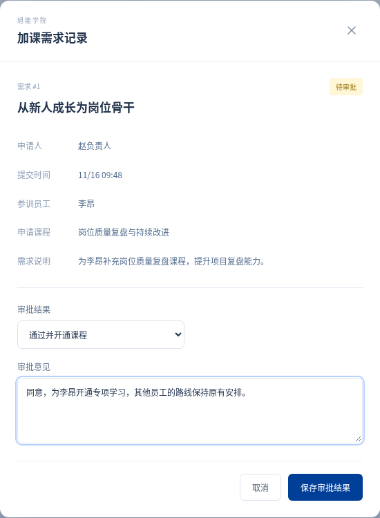
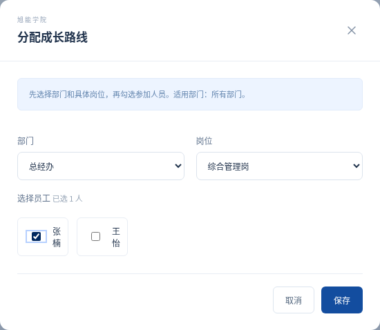

# 旭能学院：岗位、角色与加课更新

更新日期：2026-11-16。

## 本次功能

- 保留具体岗位名称，按专业岗、管理岗、综合岗分类；组织与人员支持修改岗位分类，以及员工所属部门、岗位和职级。
- 角色名称统一为普通员工、内训师、部门负责人、组织发展部，同一员工可兼任；员工分享课程、审核后成为内训师的流程保留。
- 成长路线分配人员必须先选择部门和具体岗位，再勾选人员；切换筛选时清空勾选。后端校验整批人员，不符合条件时不产生部分分配。
- 部门负责人可为授权部门内的员工申请补充课程；组织发展部审批或驳回并保存处理记录，通过后才给选定员工开通课程。
- 组织发展部可跳过申请，直接授权课程给某个员工或选定人员；已有课程完成状态和学习进度保留，操作写入审计并通知员工。
- 加课是个人任务，不修改共享路线阶段；负责人只能查看授权部门的数据，不能使用组织发展部的直接授权功能。

## 离线体验步骤

解压后打开 `旭能学院-离线演示.html`，右上角切换身份：

1. **组织发展部 · 林**：进入“组织与人员 → 岗位与类型”，查看三类岗位，编辑具体岗位的分类。员工列表可编辑资料和设置角色、负责人授权部门。
2. **部门负责人 · 赵**：进入“加课需求 → 提交加课需求”。新演示数据中可以选择“岗位质量复盘与持续改进”、运营管理部、培训讲师岗位、李昂，填写说明后提交；需要时关联其现有成长路线。
3. **组织发展部 · 林**：进入“课程授权与需求”，查看并审批刚才的申请。通过或驳回都必须填写意见。
4. 可在同页点击“直接授权课程”，例如把课程授权给总经办、综合管理岗的张楠，再切换普通员工张楠，从“我的课程”查看新任务。
5. 在“成长路线管理”发布路线后分配员工，先选范围内的部门、具体岗位，再勾选参加人员。

旧浏览器演示数据会保留。岗位缺失分类时先按综合岗展示；不会清空学习记录，已有员工编号不会被演示新增账号覆盖。新增样例课程出现在新演示数据中，旧数据也可以用已发布课程完成上述申请。重置会清空本地演示操作，只有希望重置样例时再使用设置中的重置按钮。

## 构建与验证

- 前端33项测试通过，覆盖既有学习/考试/预警规则，以及部门范围、需求审批、个人授权、岗位分类、历史数据兼容和权限隔离；Vue生产构建与单文件演示生成成功。
- 后端108项检查中107项通过，1项SQL Server连接检查因未配置连接跳过，无失败或错误；新版WAR已生成。新增44项测试覆盖岗位、路线分配、申请审批、个人授权、非法请求和mapper配置。
- Chromium实际操作验证普通员工工作区拦截、负责人部门范围、待审批不授权、通过后只授权选定员工、管理员直接授权后员工可见、具体岗位及类型保存、路线分配双重筛选和清空勾选。
- 390px手机弹窗无横向溢出。修正了新角色和页面名称导致的手机顶栏宽度问题。加载构建后的单文件并断网，仍可完成一次新需求提交，无页面JavaScript错误。
- 本次通过本地HTTP打开单文件后断网测试，未直接验证 `file://` 双击。本次没有连接真实SQL Server执行迁移或进行Tomcat实库端到端联调。

机器可读结果见 `岗位角色与加课测试结果.json`。

## 正式系统升级

数据库管理员对现有培训库先确认已执行 `02-add-path-departments.sql`，再执行 `03-position-types-learning-requests.sql`，之后更新 `training.war`。不需要新建数据库，不要重新执行全量建表脚本。全新数据库使用最新版 `01-schema.sql`。

岗位三分类是新增字段，旧岗位默认综合岗，名称、编号和原有学习结果保留，可在前端按实际情况分类。组织发展部、内训师、负责人使用原权限代码，既有角色配置继续生效。
