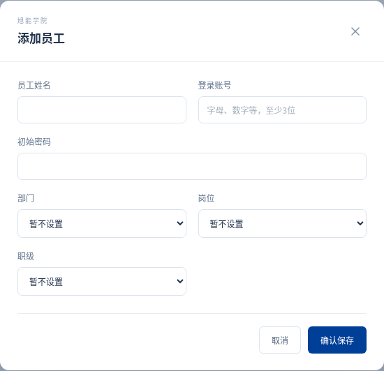
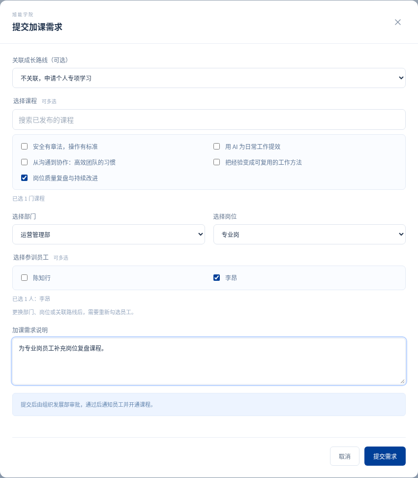

# 旭能学院：固定三岗位与加课功能

更新日期：2026-11-16。本次按最新确认修正岗位含义。

## 岗位只有三个

岗位本身就是 **专业岗、管理岗、综合岗**，没有具体岗位名称、子岗位或岗位分类管理。员工新增与资料编辑、成长路线的适用岗位、分配人员和加课筛选都直接选择这三个岗位。路线可选择不限定岗位；员工资料中的“暂不设置”是空值占位，不是第四种岗位。

组织字典只维护部门和职级，不能新增、改名或重新分类岗位。岗位与角色独立，选择管理岗不会自动获得部门负责人权限。

## 已有功能继续使用

角色为普通员工、内训师、部门负责人、组织发展部，同一员工可兼任。员工分享课程、审核后成为内训师的流程保留。

路线分配先选择部门和岗位，再手动勾选员工；更换筛选清空勾选。部门负责人可为授权部门员工申请加课，组织发展部审批或驳回并保存意见，审批通过后才为所选员工开通课程。组织发展部也可直接授权给指定员工，不修改其他员工共用的路线阶段，已有学习进度和完成状态保留。

## 离线体验

解压后打开 `旭能学院-离线演示.html`，右上角切换身份：

1. **组织发展部 · 林**：进入“组织与人员”，新增或编辑员工，岗位下拉框只有专业岗、管理岗、综合岗。新增组织字典只提供部门、职级。
2. 进入“成长路线管理”，新建路线的适用岗位直接选择三者之一或不限定；发布后选择部门、岗位和人员进行分配。
3. **部门负责人 · 赵**：进入“加课需求”，选择课程、运营管理部、专业岗和李昂，填写需求后提交。
4. **组织发展部 · 林**：进入“课程授权与需求”，审批该需求；也可直接给总经办、综合岗的张楠授权课程。
5. 切换普通员工张楠，在“我的课程”查看获授权课程。

旧浏览器演示数据自动归并，不需要重置：标准名称优先匹配，其余沿用旧内部分类映射。员工和路线的岗位关联会同步更新，学习记录和审批结果保留，旧名称与编号映射在演示数据中存档。

## 验证记录

- 前端34项测试通过，生产构建和单文件生成成功，覆盖固定岗位、禁用自定义、旧数据归并、学习记录保留，以及既有申请审批与学习规则。
- 后端114项中113项通过，1项SQL Server连接检查因未配置连接跳过，无失败或错误，重新生成WAR。已验证固定岗位接口、非法岗位拒绝、角色独立性和原有业务规则。
- Chromium实测员工岗位下拉框恰好三项、无子分组和自定义岗位入口；组织字典仅有部门与职级；路线选岗、部门岗位筛选、负责人申请及审批正常。
- 390px手机布局无横向溢出。浏览器旧数据合并后，员工和路线指向对应固定岗位，学习任务与已通过审批保留；同一单文件加载后断网，仍可进入新建路线并选择三个岗位，无页面JavaScript错误。
- 本次通过本地HTTP加载单文件后断网验证，未直接验证 `file://` 双击；没有连接真实SQL Server执行迁移或完成Tomcat实库联调。

机器可读记录见 `岗位角色与加课测试结果.json`。

## 正式升级

现有数据库由DBA按版本确认02、03已执行，再执行 **04-fixed-positions.sql**，最后部署新版 `training.war`。全新数据库使用最新01，自动初始化三个岗位，无需再执行增量脚本。无需新建数据库，不要重跑全量建表脚本。

04会合并旧岗位，并更新员工和路线的岗位引用；旧名称、编号与映射记录在 `position_migration_archive`，学习任务、进度、成绩、角色和审批记录保留。增量脚本支持重复执行和异常回滚，尚未在真实SQL Server执行验证。
