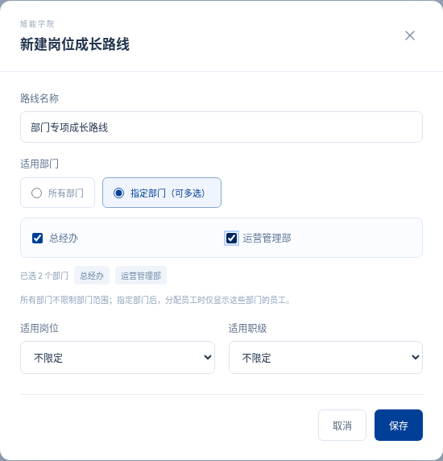

# 成长路线适用部门更新

更新日期：2026-11-16。项目：旭能学院。

## 使用方法

1. 切换管理员，进入“成长路线管理”，点击“新建路线”。
2. 填写名称，在新增的“适用部门”中选择“所有部门”，或切换“指定部门（可多选）”后勾选一个或多个部门。
3. 保存后，路线详情显示适用部门。配置阶段并发布，点击“分配员工”手动选择参加人员；名单只显示范围内的启用员工。

默认选中所有部门；指定部门必须至少勾选一个。部门来源为“组织与人员”中维护的部门，不需要在代码中添加。所有部门也包含以后新建的部门和暂未设置部门的员工。部门范围用于限定适用对象，保存或发布路线不会自动分配全部门员工。

旧路线继续视为所有部门，不修改已有分配、课程学习记录或成绩。指定部门的路线如果混入范围外员工，后端会拒绝整批请求，避免部分分配。

## 数据库升级

离线演示不需要数据库，更新 HTML 后即可体验；已有浏览器演示数据兼容，不必重置。

已部署的正式系统先由有权限的数据库管理员对现有培训数据库执行 `sys/database/02-add-path-departments.sql`，再部署新版 `training.war`。这是可重复执行的增量脚本，新增部门范围字段与关联表，不需要新建数据库或重新执行全量建表脚本。全新环境使用最新 `01-schema.sql` 即可。

## 验证记录

- 前端 `npm test`：19 项通过，含新增的 8 项部门范围规则测试；`npm run build` 成功，重新生成离线 HTML。
- 后端 `mvn clean verify`：64 项中 63 项通过、1 项 SQL Server 实库检查因未配置连接跳过，无失败或错误，生成新版 WAR。
- Chromium 桌面 1440px / 手机 390px：默认所有部门、指定空选禁止保存、多部门保存与刷新保留、单部门分配名单过滤、不自动勾选员工等检查通过，无页面 JavaScript 错误，手机无横向溢出。
- 同一构建后的单文件通过本地 HTTP 加载后断网，部门选择交互仍可用。本次未直接验证浏览器 `file://` 双击打开。
- 前端、演示适配与后端字段契约、增量 SQL 已静态复核。尚未连接真实 SQL Server 执行迁移，也未进行真实 Tomcat 与 SQL Server 的端到端联调。

机器可读结果见 `部门范围测试结果.json`。
